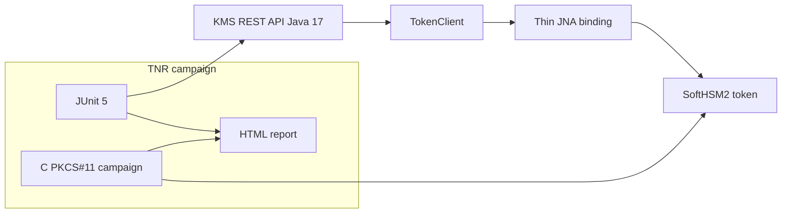

# hsm-kms-tnr

Non-regression bench for a small KMS REST API backed by a PKCS#11 token.
The token is [SoftHSM2](https://www.opendnssec.org/softhsm/). It stands in for an HSM during development and IVVQ: same Cryptoki calls, no claim that the module is certified, and no claim about Thales ProtectServer behaviour.

Latest published report (after Pages is enabled on `main`): <https://realnribal.github.io/hsm-kms-tnr/>

[](https://github.com/realnribal/hsm-kms-tnr/actions/workflows/tnr.yml)

## Résumé

Banc de non-régression pour une API de KMS adossée à un jeton PKCS#11.
SoftHSM2 tient lieu de HSM ouvert : ce dépôt ne décrit pas ProtectServer et ne prétend pas à un module certifié.
La campagne couvre le cycle de vie des clés (AES, RSA, EC), le wrap/unwrap, la signature, les cas négatifs (mauvais PIN, mécanisme incompatible, signature altérée, clé absente) et un budget de latence.
Un programme C parle à SoftHSM sans passer par Java. Chaque essai porte un identifiant d'exigence. Le rapport HTML donne le verdict, l'écart avec la campagne précédente, et un extrait de log (nom CKR, trace id).
Rejeu local : `docker compose up --build --abort-on-container-exit --exit-code-from campaign`.

## What this is for

Henri Cécé Balamou is a senior IVVQ / QA and AI engineer. The work this repository shows is the part of that job that can be replayed in public: define a TNR strategy, validate a crypto API against a PKCS#11 token, read a failure down to the CKR, and publish a report someone else can run again.

The production shape it refers to is a proprietary KMS in front of an HSM, with a campaign in C and Java, tickets, and a release train. The code here is a lab double of that shape. SoftHSM2 is the token. The requirements, the entry and exit criteria, and the regression rule are the part a reviewer can grade.

## Architecture



`TokenClient` keeps one read-write session, serializes every call, and finds objects by label. Handles are not cached: PKCS#11 handles are session-scoped, labels are the stable name. The REST layer never returns key bytes. A wrong-PIN probe logs the user out, tries the candidate, then logs the lab PIN back in, because SoftHSM keeps a single login state per process.

## Why this PKCS#11 binding

The JDK ships SunPKCS11. It is the right tool when every key can share one static attribute template. This API cannot: each key has its own `CKA_TOKEN`, `CKA_SENSITIVE`, `CKA_EXTRACTABLE` and usage flags, and the negative tests need the raw `CK_RV`. IAIK's PKCS#11 wrapper is not freely redistributable. jacknji11 would also work. A thin JNA binding keeps the native surface in one package, with JNA as the only extra dependency, so a reviewer can read the calls. The binding is LP64 only (`CK_ULONG` is 8 bytes): Linux x86_64 and aarch64, which is what CI and the container use. SoftHSM2 exports the standard `C_*` symbols, so the Java client and the C campaign call the same library.

## TNR strategy

### Scope

In scope: key lifecycle (AES-128/256, RSA-2048, EC P-256), AES-CBC-PAD, AES key wrap, RSA-PKCS wrap of an AES key, SHA-256 RSA and ECDSA sign/verify, error mapping, log hygiene, a latency smoke budget, traceability, and the report itself.

Out of scope, and listed as such on the report rather than skipped in silence:

| Id | Reason |
| --- | --- |
| REQ-OOS-001 | Certified boundary (FIPS 140-3 / Common Criteria). SoftHSM2 is not a certified module. |
| REQ-OOS-002 | Vendor mechanisms and attributes, including Thales ProtectServer. Not claimed. |
| REQ-OOS-003 | Multi-token failover. |
| REQ-OOS-004 | mTLS, partition ACLs, an identity provider. The lab API key is only a campaign control. |

The catalog is [`requirements/catalog.json`](requirements/catalog.json). The same ids are in [`REQUIREMENTS.md`](REQUIREMENTS.md). A JUnit test fails the build if an in-scope Java requirement has no `@Requirement` method, or if an id is missing from the markdown.

### Levels

1. Functional. Nominal key management and crypto, including a wrap that is only accepted once the unwrapped key decrypts ciphertext from the original key.
2. Robustness. Unknown alias, duplicate alias, mechanism that does not match the key, tampered signature, wrong verification key, non-extractable wrap, wrong PIN.
3. Non-functional. Mean of five calls under a 2000 ms budget for AES key generation and for RSA sign. This is a smoke budget so a hang or a pathological regression fails the campaign. It is not a load test.
4. Native. A C program linked with gcc/CMake talks to SoftHSM directly, so a Java binding failure can be compared with a second client on the same token.
5. Traceability and report. The matrix is complete, and the HTML generator flags a requirement that passed last time and does not pass now.

### Entry criteria

- SoftHSM2 is installed and `scripts/init-token.sh` has created the token `kms-token`.
- Java 17, Maven, gcc and CMake are on the path (or the container image is used).
- The requirements catalog and the tests land in the same change.
- A red requirement from the previous campaign is triaged before the run is treated as a release candidate. The tool does not auto-waive it.

### Exit criteria

- Every in-scope requirement is PASS. `NOT_RUN` fails the campaign the same way a failure does.
- The HTML report is archived.
- The application log contains CKR names and trace ids, and does not contain the lab PIN, the SO PIN, the API key, or the rejected PIN.
- Latency samples are inside the budget.

### Regression policy

- CI is red when any in-scope requirement is FAIL or NOT_RUN.
- A requirement that was PASS in the previous archived campaign and is not PASS now is called out as a regression on the report.
- A new behaviour needs a new requirement id, a catalog row, and a test in the same commit. `REQ-TRC-001` enforces that for the Java campaign.
- Out-of-scope rows stay in the catalog with a reason. They are not silent skips.
- A flaky test is a defect. The campaign is not re-run until green without a code or environment change.

## How to run

Docker, one command from a checkout:

```bash
docker compose up --build --abort-on-container-exit --exit-code-from campaign
```

The report is written to `site/index.html` and `reports/tnr-report.html`. To start only the API:

```bash
docker compose --profile api up --build api
```

Without Docker, on Ubuntu:

```bash
sudo apt-get install -y openjdk-17-jdk maven softhsm2 gcc cmake make
./scripts/run-campaign.sh
```

The script initialises the token, builds the C campaign with gcc, runs JUnit, and writes the report. Exit status is non-zero unless every in-scope requirement passed.

API only, after the token exists:

```bash
./scripts/init-token.sh
set -a; source .softhsm/env; set +a
cd kms-api && mvn -B -DskipTests package && java -jar target/kms-api.jar
```

Lab fixtures, set by the init script and overridable by the environment: token label `kms-token`, user PIN `tnr-user-pin-7f3a`, API key header `X-API-Key: lab-api-key-7f3a`. These are campaign fixtures. They are not the credentials of a real HSM, and the application log is tested to make sure it does not record them.

CI runs the same `./scripts/run-campaign.sh` on every push and pull request, on Temurin 17, and uploads `site/` as the `tnr-report` artifact. A push to `main` also deploys that report to GitHub Pages.

## How to read the report

Open `site/index.html`.

- The stamp is the verdict. PASS means every in-scope requirement passed.
- The trend line is this pass rate minus the previous archived campaign. The first run has no previous file and says so. Later runs use `reports/history/` (CI restores it from the actions cache).
- "Regressions" lists requirements that were PASS and are not anymore. "Recovered" lists the opposite move.
- The matrix is one row per requirement: id, level, status, the test that produced the evidence, and for the latency rows the measured mean against the budget.
- "Failure log" quotes the assertion or the CKR for each failure. "Robustness evidence" quotes log lines that contain a CKR name or a warning. A 404 response carries `X-Trace-Id`; the same value is in the log as `trace=`.
- Out-of-scope rows are on the matrix with status `OUT_OF_SCOPE`. They do not affect the verdict.

## API

All routes except `GET /api/v1/health` require `X-API-Key`. Bodies are JSON. Binary fields are standard Base64. Aliases match `[A-Za-z0-9][A-Za-z0-9._-]{0,63}`.

| Method | Path | Role |
| --- | --- | --- |
| GET | `/api/v1/health` | Token label, Cryptoki version, manufacturer. No API key. |
| POST | `/api/v1/keys` | Create an AES, RSA or EC key on the token. |
| GET | `/api/v1/keys` | Metadata only. |
| GET | `/api/v1/keys/{alias}` | One key's metadata. |
| DELETE | `/api/v1/keys/{alias}` | Destroy every object with that label. |
| POST | `/api/v1/crypto/encrypt` | AES-CBC-PAD. The IV is generated when omitted and returned. |
| POST | `/api/v1/crypto/decrypt` | AES-CBC-PAD. |
| POST | `/api/v1/crypto/sign` | `SHA256withRSA` or `SHA256withECDSA`. |
| POST | `/api/v1/crypto/verify` | `{ "valid": true/false }`. A bad signature is not an HTTP error. |
| POST | `/api/v1/crypto/wrap` | `AES_KEY_WRAP` or `RSA_PKCS`. |
| POST | `/api/v1/crypto/unwrap` | Restore an AES key under a new alias. |

Errors are `{ "code", "message", "traceId", "ckR" }`. `ckR` is present when the token refused the call. PKCS#11 failures become 400 (`KEY_NOT_EXTRACTABLE`, `MECHANISM_MISMATCH`) or 502 (`HSM_ERROR`) with the symbolic CKR name. Unknown alias is 404. Duplicate alias is 409.

ECDSA note: this SoftHSM build advertises `CKM_ECDSA` and not `CKM_ECDSA_SHA256`. The service hashes with SHA-256 and the token signs the 32-byte digest. The signature is raw R\|\|S (64 bytes on P-256), which is what PKCS#11 returns, not ASN.1. RSA signatures use `CKM_SHA256_RSA_PKCS`, so the token does the hash.

## Limits

- SoftHSM2 is not a certified HSM. A pass here is not a FIPS or Common Criteria result.
- Nothing in this repository is ProtectServer-specific. Vendor mechanisms, secure messaging and vendor attributes are out of scope on purpose.
- One session, one process-wide lock. The latency checks are a budget, not a throughput claim.
- The lab API key is not mTLS and not a partition ACL.
- The binding is LP64 only.
- Unwrapped AES keys on this SoftHSM build do not expose `CKA_VALUE_LEN` (`CKR_ATTRIBUTE_READ_ONLY` if the template sets it). The response repeats the size the caller declared. The campaign proves the key by decrypting with it.
- ECDSA hashing is in the JVM, as described above.

## Layout

```
kms-api/          Java 17 Spring Boot API, JUnit campaign, report generator
native/           C PKCS#11 campaign (gcc / CMake)
requirements/     machine-readable catalog
scripts/          token init, campaign, container entry
.github/workflows/tnr.yml
Dockerfile
docker-compose.yml
```

## Publishing the report

The Pages job runs only on a push to `main`, and only after the campaign is green. GitHub will not deploy until Pages is switched to the Actions source. That setting is in the repository, not in this workflow. See the pull request description for the exact click-path.
